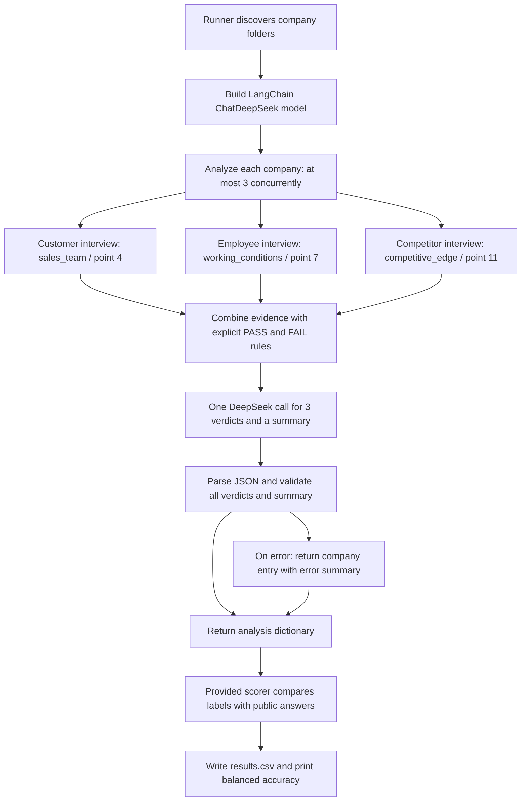

# FTEC5660 Homework 3: Fisher's 15-Point Investment Agent

Build a LangChain agent that researches a company with tools and applies the
framework from Philip Fisher's *Common Stocks and Uncommon Profits* (Part One,
Chapter 3 "What to buy: the fifteen points to look for in a common stock", and
Chapter 4 "What to buy: applying this to your own needs"). You choose 3 of
Fisher's 15 points and decide yourself what PASS means for each. For every
company your agent gives a PASS/FAIL verdict on your 3 points and a short
summary.

The companies are fictional, so the model cannot answer from memory. Unlike a
pile of reports, the evidence is spread over three sources, and your agent has
to go and get it with tools, the way Fisher's "scuttlebutt" method sends an
investor to talk to customers, competitors, suppliers and staff.

## Data and tools

`public_test/` has one folder per company. Your code receives four tools per
company (built by the provided code in `hw3.py`):

| Tool | What it gives you |
| --- | --- |
| `list_documents()` | the company's six documents and their dates |
| `read_document(name)` | one document: the 2025 letter to shareholders, four earnings calls (Q3 2025 to Q2 2026) and a news file (July 2025 to July 2026) |
| `sql_query(query)` | one read-only SQLite query on the company's database; at most 50 rows come back, so use `SUM`, `GROUP BY` and `WHERE` |
| `interview(role, topic)` | what one person says about the company; at most **10 interviews per company** |

The documents are what management says. Management's own claims (such as "we
have never cut research" or "our people are our greatest strength") are not
evidence on their own: check them against the database and the interviews.

**Database tables** (amounts in USD thousands; dates `YYYY-MM-DD`, months
`YYYY-MM`, quarters like `2025Q3`; the fiscal year is the calendar year):

| Table | Columns |
| --- | --- |
| `company` | name, industry |
| `industry_medians` | industry, revenue_growth_2y_pct, new_product_share_pct, new_product_sales_per_rd, operating_margin_pct (one row per industry; use the row for the company's own industry) |
| `orders` | order_id, order_date, product, customer, amount, note (about 3,000 to 4,000 orders from January 2023 to June 2026; revenue is the sum of order amounts) |
| `products` | product, launch_date |
| `monthly_costs` | month, cost_of_sales, selling_admin, research_development |
| `quarterly_cash` | quarter, operating_cash_flow, capex, cash_end |
| `capex_plan` | year, planned_capex (2026 to 2028) |
| `returns` | month, units_shipped, units_returned |
| `insider_trades` | trade_date, person, title, side (`buy` or `sell`), shares, price |

**Terms used in the data.**

| Term | Meaning |
| --- | --- |
| FY2025 | Fiscal year 2025. Here the fiscal year is the calendar year, so FY2025 is January to December 2025. |
| Quarter | Three months of the year: Q1 is January to March, Q2 April to June, Q3 July to September and Q4 October to December. The database writes `2025Q3`; the documents write "third quarter 2025". |
| Amounts | The database is in **USD thousands** (676,100 means US$676.1 million). The documents use USD millions. |
| Revenue | Money from sales: the sum of `amount` in `orders`. |
| Cost of sales | The cost of making the products that were sold. |
| Selling and admin | The cost of selling and of running the company (sales staff, offices, management). |
| R&D | Research and development spending, mainly on new products. |
| Operating margin | Operating profit as a share of revenue: (revenue − cost of sales − selling and admin − R&D) ÷ revenue. |
| Operating cash flow | Cash that the day-to-day business brings in during a quarter. |
| Cash at the end of a quarter | The cash the company holds on the last day of that quarter (`cash_end`). |
| Capex | Capital expenditure: spending on factories, machines and other long-term assets. `capex_plan` holds the planned capex for 2026 to 2028. |
| Return rate | Units returned ÷ units shipped, from the `returns` table. |
| Industry median | The middle value for companies in the same industry, from `industry_medians`. |
| Insider | A director or senior manager of the company. `insider_trades` lists the shares they bought (`buy`) or sold (`sell`). |
| Earnings call | A meeting each quarter where management presents the quarter's results to investors. Each call quotes that quarter's revenue. |

**Interviews.** Roles: `customer`, `current_employee`, `former_employee`,
`competitor`, `supplier`. Topics: `sales_team`, `working_conditions`,
`top_management`, `decision_making`, `competitive_edge`. Only some people know
about each topic; the others say they can't comment, and that answer still
uses up one interview.

| Topic | Who knows about it |
| --- | --- |
| `sales_team` | customer, competitor |
| `working_conditions` | current_employee, former_employee |
| `top_management` | former_employee, supplier |
| `decision_making` | supplier, customer |
| `competitive_edge` | competitor, customer |

People who know about a topic always agree with each other, so one good answer
is enough.

## Choose your 3 points and your rules

Pick any 3 of Fisher's 15 points and write them in `CHOSEN_POINTS` near the
top of `hw3.py`, e.g. `CHOSEN_POINTS = [1, 7, 15]`. The full questions are in
`FISHER_POINTS` in `hw3.py` and in the book.

| # | Fisher's point | Where the evidence is |
| --- | --- | --- |
| 1 | Market potential for sales growth | database |
| 2 | New products as current lines mature | database |
| 3 | Effective research and development | database |
| 4 | Above-average sales organization | interviews (`sales_team`) |
| 5 | Worthwhile profit margin | database |
| 6 | Maintaining or improving margins | database |
| 7 | Labour and personnel relations | interviews (`working_conditions`) |
| 8 | Executive relations | interviews (`top_management`) |
| 9 | Depth of management | interviews (`decision_making`) |
| 10 | Cost analysis and accounting controls | earnings calls, checked against the database |
| 11 | Advantage over competitors | interviews (`competitive_edge`) |
| 12 | Long-range outlook on profits | database |
| 13 | Growth without dilutive equity financing | database |
| 14 | Management talks freely about troubles | earnings calls, checked against the database |
| 15 | Management of unquestionable integrity | news file, checked against the database |

For each of your points, **you design the rule**: which evidence to use, what
to compute or whom to ask, and where the line between PASS and FAIL lies. PASS
means the company looks favourable on that point, as Fisher would see it.

We grade your verdicts against our own answer key. It uses one fixed rule per
point, which we do not publish, and the data never puts a company close to
the line of that rule, so a sensible reading of Fisher usually gives the same
answer. **Test your rules on the public answers**:
`public_test/ground_truth.json` gives the expected verdict on all 15 points
for each of the 20 public companies, and every point fails in 6 of them. If
your rule disagrees with the public answers, rethink it.

**Tip: calculate with tools, not in your head.** Do every sum, ratio and
comparison in SQL or Python, including the number of days between two dates
(SQLite's `julianday()` gives a date as a number of days).

## Student task

Fill in the three places in `hw3.py` marked `### YOUR CODE HERE`. You may add
imports, constants and helper functions above them, but do not change the
provided code below them:

- `CHOSEN_POINTS` lists your 3 points.
- `build_agent()` creates your model and anything else you need once.
- `analyze_companies(agent, companies)` receives
  `{company_folder: [list_documents, read_document, sql_query, interview]}`
  and returns, for every company,
  `{"points": {1: "PASS", 7: "FAIL", 15: "PASS"}, "summary": "..."}` (here with
  `CHOSEN_POINTS = [1, 7, 15]`).

Use the course techniques that fit your points: tool use for the database and
the interviews, planning which interviews to spend, routing each point to the
right source, prompt chaining, parallel calls, reflection to check your
answers, or a combination. Your code must read company data **only through
the four tools**; do not open `company.db` or `interviews.dat` yourself. Do
not hard-code folder names, company names or the public answers.

## Setup and public test

```bash
python3 -m venv .venv
source .venv/bin/activate
pip install -r requirements.txt
echo "DEEPSEEK_API_KEY=your_key_here" > .env
python3 hw3.py --data-folder public_test
```

Use your own DeepSeek API key (from https://platform.deepseek.com). The
required model is `deepseek-v4-flash`. We grade with our own key, so never put
a key in your code; `.env` must stay out of git.

The program creates `results.csv` with the columns `company`, `points`,
`points_correct`, `point_errors`, `interviews_used` and `summary`, and prints
the point score on your 3 points (the percentage after "balanced"). The point
score is the average of two shares: the share of truly passing verdicts that
you marked PASS and the share of truly failing verdicts that you marked FAIL.
For example, 90% and 60% give (90% + 60%) / 2 = 75%, and marking every point
PASS gives (100% + 0%) / 2 = 50%. Once `CHOSEN_POINTS` is set, the starter
runs before you add any API code (it returns no verdicts, so it scores 0%).

`public_test/ground_truth.json` gives the expected verdicts on all 15 points
for each public company. Grading uses a private set of about 20 unseen
companies with the same tools and the same answer key rules, but different
names and wording, and scores your 3 points only.

## Homework 3 solution

### My 3 points and rules

I selected points **4, 7 and 11** because they assess three complementary sources of business quality: the sales organization, employee relations and competitive positioning. They also suit Fisher's approach of seeking evidence from people who deal with a business. The assignment identifies interviews as the relevant evidence for all three points, allowing a focused research plan within the interview budget.

| Point | Why I chose it | PASS / FAIL rule | Evidence used |
| --- | --- | --- | --- |
| 4 - Above-average sales organization | Customers can observe whether sales staff understand their operations and provide useful support. This helps assess the quality of the commercial organization. | PASS when the interview supports an above-average sales organization with knowledgeable, effective and responsive staff. FAIL when sales capability is weak or below competitors. | `interview(role="customer", topic="sales_team")` |
| 7 - Labour and personnel relations | Employee relations provide a perspective on organizational quality beyond management's own claims. | PASS when the evidence supports outstanding personnel relations through fair treatment, trust and positive working conditions. FAIL when it indicates poor treatment, serious dissatisfaction or unhealthy relations. | `interview(role="current_employee", topic="working_conditions")` |
| 11 - Industry-specific competitive advantage | Competitive positioning helps distinguish a business with defensible strengths from one whose products can be readily copied. | PASS when the interview supports a meaningful, defensible industry-specific advantage. FAIL when that advantage is absent, easily copied or undermined by the evidence. | `interview(role="competitor", topic="competitive_edge")` |

These are qualitative decision rules implemented in the model prompt. The model must base its verdicts on the interview evidence and attend to negative statements, rather than infer favourable answers from company names or general knowledge. This is a focused operational interpretation of the selected Fisher points, rather than a complete investment assessment.

### Design



The design uses a fixed research plan: route each selected point to a knowledgeable interview source, collect three answers, and send them together to `deepseek-v4-flash` through LangChain. The model is created once with `temperature=0`; it is reused for one model invocation per company. An `asyncio.Semaphore(3)` limits concurrent company analyses, while `asyncio.gather` collects results. Interviews are called synchronously inside each company task; the concurrent work primarily overlaps model requests. This is a programmed tool workflow with model-based evaluation, rather than an autonomous loop in which the model chooses its own tools. JSON parsing verifies the three labels and a non-empty summary. Exceptions are caught per company, allowing other companies to finish; the failed company's missing labels are counted as wrong by the scorer.

The implementation uses **3 of the 10 allowed interviews per company**. According to the assignment, knowledgeable respondents agree with each other, so one relevant source per topic is sufficient for this dataset. Documents and SQL are available but are not needed for these selected points. The student analysis reads company evidence only through the supplied interview tool. Standard answers are read later by the provided scorer, after the analyses have been returned. No public labels or company-specific answers are embedded in the student implementation. The provided tools, runner and scoring code remain unchanged.

### Results

The saved public-test run processed **20 companies** and produced `results.csv` with **60/60 correct verdicts** and **100.0% balanced accuracy**. The saved results were checked against `public_test/ground_truth.json`:

| Point | Correct standard-PASS cases | Correct standard-FAIL cases | Total correct | Balanced accuracy |
| --- | --- | --- | --- | --- |
| 4 | 14/14 | 6/6 | 20/20 | 100.0% |
| 7 | 14/14 | 6/6 | 20/20 | 100.0% |
| 11 | 14/14 | 6/6 | 20/20 | 100.0% |
| All selected points | 42/42 | 18/18 | 60/60 | 100.0% |

Balanced accuracy is `(correct PASS / actual PASS + correct FAIL / actual FAIL) / 2`, pooling the selected company-point decisions. Here it is `(42/42 + 18/18) / 2 = 100%`. All 20 company rows show `3/3` correct, have no point errors, and record three interviews. Total interview use was **60**. There are **no companies with disagreements** in this saved run, so there are no observed classification errors to explain. No analysis-error summaries were found.

This result describes one successful public-test run, not a three-run average or a private-test result. It supports the suitability of the chosen rules on the public data but does not guarantee the same performance on unseen wording. Relevant limitations are reliance on one source per topic, model interpretation of negation and nuance, and the lack of an explicit retry policy in the student code for malformed outputs. Temperature zero reduces sampling variability but does not guarantee identical responses. In less controlled data, contradictory or incomplete interviews would require additional evidence rather than confidence based on this public score alone.

### Reproducing the run

From the repository root, with Python 3.10 or newer:

```bash
python3 -m venv .venv
source .venv/bin/activate
python -m pip install -r requirements.txt
```

Create a local `.env` containing `DEEPSEEK_API_KEY` with your own key, then run:

```bash
python hw3.py --data-folder public_test
```

The runner writes `results.csv` and prints the point score. Keep `.env` and `.venv` out of the submission. The existing requirements already cover this implementation; no additional package is needed. A fresh environment and end-to-end API run should be checked before submission. The reported 100.0% is from the saved run, not a newly repeated run during report preparation.

### Task 2: Reflection on AI sycophancy and AI psychosis

AI sycophancy raises an important question for an assistant: should it make a user feel agreed with, or help the user reach a better-supported conclusion? I think useful assistance requires the second goal. If a user proposes that a company is excellent, an assistant should still examine evidence against that claim. A fluent explanation is not a substitute for independent support.

For this reflection, I use “AI psychosis” as an informal label for concerns about interactions that reinforce unsupported beliefs, not as a diagnosis or a claim that AI causes a particular disorder. The design problem I want to consider is a feedback loop: a user expresses a belief, the assistant validates it without sufficient evidence, and the user treats that validation as new confirmation. Further conversation may then build on an assumption that was never established. An assistant can acknowledge a person's feelings without endorsing the factual claim behind them.

The homework illustrates why separating evidence, judgment and evaluation matters. The model receives interview evidence and explicit criteria; the supplied scorer subsequently compares the model's labels with independently supplied public answers. If I asked the model to praise its own solution and treated that praise as validation, I would have no independent check. Even the observed 100% public score has a limited meaning: it shows agreement on this dataset, not universal reliability or proof that the system understands every business situation.

My preferred design would make the basis for each judgment visible, invite consideration of counterevidence, and communicate uncertainty when the evidence is incomplete. In a financial application, I would avoid presenting a model's reassuring tone as a reason to invest. For conversations about troubling beliefs, I would favour calm, respectful responses that distinguish what is known from what is assumed, rather than elaborate on unsupported explanations. The goal is to support a person's ability to assess claims, not make the assistant the sole source of certainty.

There is also a tension between accuracy on a fixed benchmark and honesty about uncertainty. This homework requires PASS or FAIL, but a real research system should be able to say that available evidence is insufficient and identify what further information would help. My main takeaway is that a helpful agent needs both a useful task workflow and boundaries on its claims. It should make evidence easier to inspect and remain willing to disagree respectfully, including when agreement would be more pleasing.
